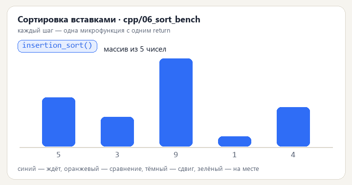

# C++-часть

8 консольных программ на C++17. Сборка одной командой через CMake — все цели объявлены в `CMakeLists.txt`:

<p align="center">
  <br>
  <sub>Так выглядит структурный стиль в движении — <a href="https://kepanasyuke.github.io/structured-programming-labs/">живая объяснялка</a></sub>
</p>

```bash
cmake -S . -B build
cmake --build build --config Release
```

Запуск (путь к данным можно не указывать — программа сама найдёт файл в `data/` или `../../data/`):

```bash
./build/01_text_stats
./build/02_csv_profiler ../../data/clients.csv
```

Компилятор: MSVC 2019+, GCC 9+, Clang 10+. Флаги предупреждений включены (`/W4` для MSVC, `-Wall -Wextra -Wpedantic` для остальных), внешних зависимостей нет.

Почему здесь нет классов: задача — показать структурное программирование. Есть только `struct` как набор данных (`ColumnProfile`, `LogRecord`, `Date`, `Period`) и свободные функции, которые эти данные обрабатывают. Наследования нет, виртуальных функций нет, изменяемого глобального состояния нет — всё передаётся аргументами и возвращается по значению.

| Проект | Задача | Ключевые функции |
|--------|--------|------------------|
| 01_text_stats | частота слов в UTF-8 тексте, топ-N | `lowercase_utf8`, `split_words`, `count_words`, `top_words` |
| 02_csv_profiler | профиль колонок CSV | `detect_type`, `profile_column`, `fill_range`, `print_profiles` |
| 03_rpn_calc | разбор выражения и вычисление через ОПЗ | `tokenize`, `to_rpn_checked`, `evaluate_rpn`, `apply_operator` |
| 04_dq_checks | правила качества данных, контрольное число ИНН | `build_rules`, `run_checks`, `matches_ten_digit_checksum` |
| 05_log_parser | статистика по логу, p50/p95 | `parse_line`, `aggregate`, `percentile`, `print_report` |
| 06_sort_bench | три сортировки и замер через `chrono` | `insertion_sort`, `merge_sort`, `quick_sort`, `measure` |
| 07_date_periods | отчётные периоды без внешних библиотек дат | `to_days`, `from_days`, `generate_periods`, `find_gaps` |
| 08_moving_average | скользящее среднее и z-score | `moving_average`, `z_score`, `find_outliers`, `build_bar` |

Отдельно стоит отметить `07_date_periods`: там реализованы алгоритмы перевода даты в номер дня и обратно (`days_from_civil` / `civil_from_days`), поэтому арифметика дат не зависит от часового пояса и системных функций времени — важное свойство для отчётных периодов.

В `01_text_stats` разбор слов идёт по байтам UTF-8 с корректным приведением кириллицы к нижнему регистру без внешних библиотек (`ICU`, `utf8cpp` не нужны).
