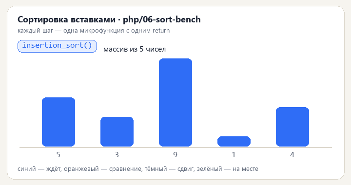
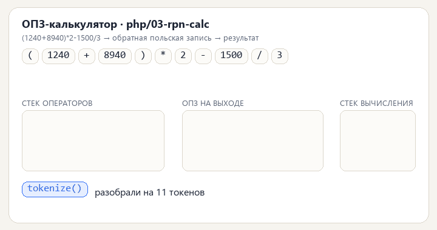

# PHP-часть

8 автономных консольных скриптов. Требуется PHP 8.1+ (нужны `mbstring` и функции `fgetcsv`, `array_multisort`).

<p align="center">
  <br>
  <sub>PHP-версия: <code>insert_item</code> → <code>shift_step</code> → <code>shift_right</code></sub>
</p>

<p align="center">
  <br>
  <sub>PHP-версия: <code>tokenize</code> → <code>to_rpn</code> → <code>evaluate_rpn</code></sub>
</p>


Каждый проект — папка с единственным файлом `index.php`, запуск:

```bash
php 01-text-stats/index.php ../../data/sample.txt
```

Без аргументов скрипт сам подставляет файл из `../../data/`.

Почему здесь нет классов: задача — показать именно структурное программирование. Разделение обязанностей достигается именами функций и соглашением `read_* → compute_* → print_*`. Исключений нет вообще: функции чтения возвращают `null`, `main()` печатает сообщение об ошибке в `STDERR` и возвращает код состояния.

| Папка | Задача | Ключевые функции |
|-------|--------|------------------|
| 01-text-stats | частота слов, топ-N, стоп-слова | `to_words`, `count_words`, `top_words` |
| 02-csv-profiler | профиль колонок CSV | `detect_type`, `profile_column`, `print_profile` |
| 03-rpn-calc | разбор и вычисление выражения | `tokenize`, `to_rpn`, `evaluate_rpn` |
| 04-dq-checks | правила качества данных | `check_row`, `run_checks`, `print_violations` |
| 05-log-parser | статистика по логу задач | `parse_line`, `aggregate`, `percentile`, `print_report` |
| 06-sort-bench | три сортировки и замер | `insertion_sort`, `merge_sort`, `quick_sort`, `is_sorted` |
| 07-date-periods | отчётные периоды | `generate_periods`, `find_intersections`, `print_periods` |
| 08-moving-average | среднее и выбросы | `moving_average`, `z_score`, `find_outliers`, `print_series` |
